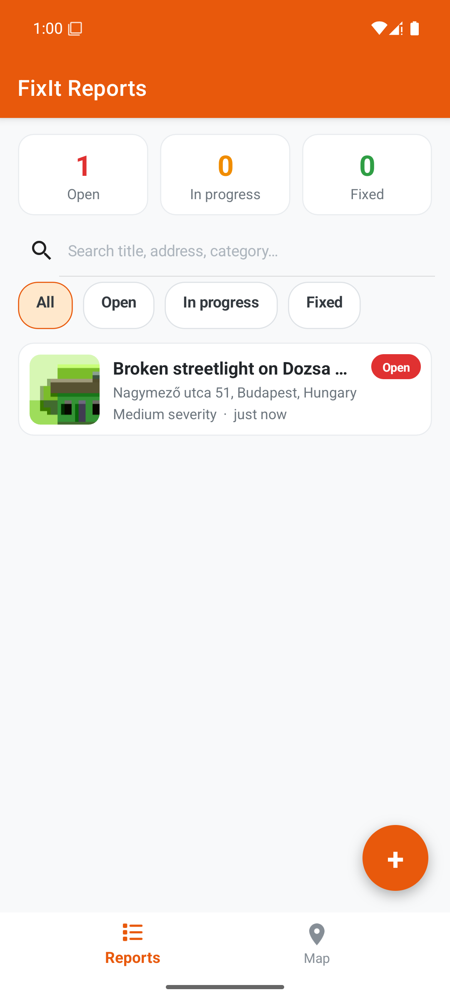
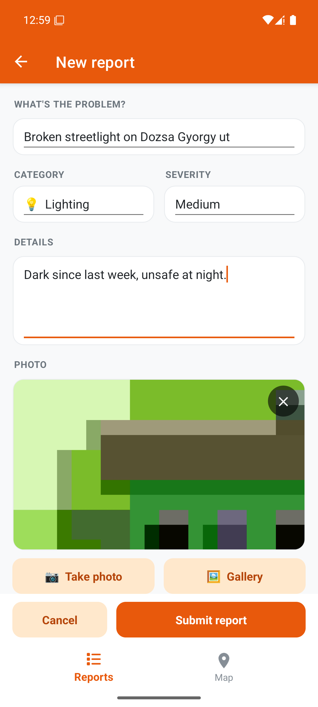
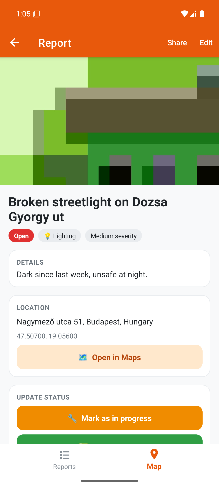
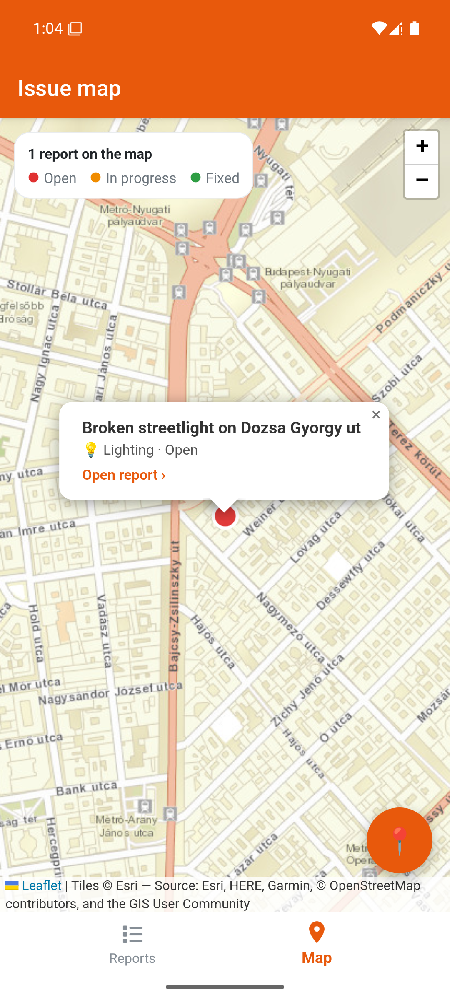
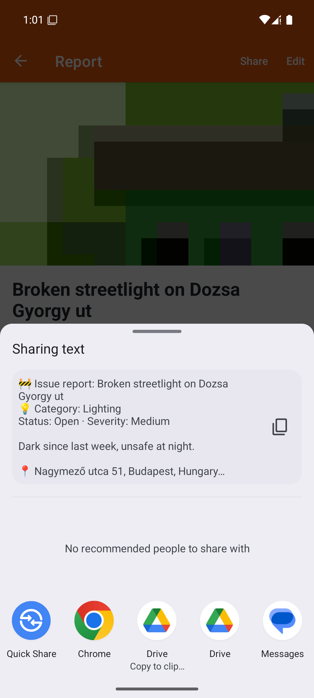
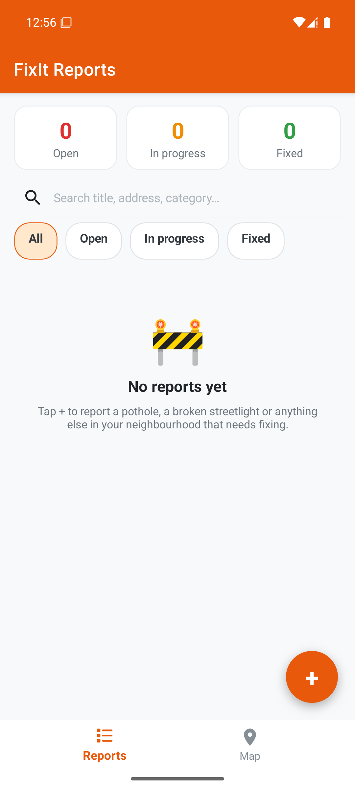

# FixIt – Project Documentation

> **For submission use [Documentation.pdf](Documentation.pdf)** (2 pages, as required). It's generated by `python docs/build_documentation.py`. This Markdown file is the longer reference version.

**Course:** .NET MAUI Semester Project
**Author:** Danial Umer
**Platforms:** Android (primary), Windows

## 1. Purpose and functionality

FixIt is a mobile app for reporting problems in public spaces, such as potholes, broken streetlights, litter, graffiti, vandalism or traffic-sign issues. On the spot, the user takes a photo, attaches their GPS position, chooses a category and severity, and adds a short description. Every report has a status (**Open → In progress → Fixed**), so the app doubles as a personal tracker for issues the user has reported to the municipality.

Main features:

- **Report list**: statistics (open / in progress / fixed), full-text search, status filter chips, pull-to-refresh, swipe-to-delete.
- **Create / edit report**: title, category, severity, status, description, photo from the camera or gallery, current GPS location with automatic street address, and input validation.
- **Report detail**: a large photo, a one-tap status workflow (mark in progress / fixed / reopen), "Open in Maps" navigation, sharing, editing and deletion.
- **Issue map**: every report shown as a pin coloured by status. Tapping a pin opens the report, and the user can show their own position.
- **Offline support**: the app is fully usable without internet. Reports saved offline keep their coordinates, and their address is resolved automatically when the connection returns.

## 2. Technologies and APIs

| Area | Technology |
|---|---|
| Framework | .NET 10, .NET MAUI (single project, Shell navigation with tabs and routes) |
| Architecture | MVVM with **CommunityToolkit.Mvvm** (source-generated `ObservableProperty` / `RelayCommand`, `WeakReferenceMessenger`) |
| Dependency injection | `Microsoft.Extensions.DependencyInjection` (built into `MauiProgram`); pages, ViewModels and services are all injected |
| Persistence | **SQLite** through `sqlite-net-pcl` (async API) |
| Device APIs (MAUI Essentials) | `MediaPicker`, `Geolocation`, `Geocoding`, `Connectivity`, `Share`, `Map`, `Permissions`, `FileSystem` |
| Map | `WebView` hosting **Leaflet** with Esri World Street Map tiles (no API key needed) |
| UI | XAML, compiled bindings (`x:DataType`), 8 value converters, styles and light/dark theme resources |

The project follows a clear folder structure:

- `Models/`: entities and enums.
- `ViewModels/`: application logic and state.
- `Views/`: XAML pages.
- `Services/`: data access and device features.
- `Converters/`: value converters.

ViewModels never reference pages. Navigation and dialogs go through the `INavigationService` and `IDialogService` abstractions.

## 3. Data model

The main entity is **`IssueReport`** (SQLite table `IssueReports`):

| Field | Type | Description |
|---|---|---|
| `Id` | int (PK, auto-increment) | Identifier |
| `Title` | string (max 100, required) | Short name of the issue |
| `Description` | string (max 1000) | Details |
| `Category` | enum `IssueCategory` | Pothole, Lighting, Litter, Graffiti, Vandalism, Traffic, Other |
| `Status` | enum `IssueStatus` | Open, InProgress, Fixed |
| `Severity` | int 1–3 | Low / Medium / High |
| `PhotoPath` | string? | Photo copied into the app's private storage |
| `Latitude`, `Longitude` | double? | GPS position |
| `Address` | string? | Reverse-geocoded street address |
| `AddressPending` | bool | Set when the report was saved offline and its address still needs to be resolved |
| `CreatedAt`, `UpdatedAt` | DateTime | Timestamps |

**CRUD** (all triggered by the user):

- **Create:** the "+" button opens the form, and the user saves it with "Submit report".
- **Read:** the list, detail and map pages.
- **Update:** the Edit page, or the status buttons on the detail page.
- **Delete:** swipe a report on the list, or use the "Delete report" button on the detail page. Both ask for confirmation, and the photo file is deleted as well.

## 4. Device features

1. **Camera:** the user photographs the issue (`MediaPicker.CapturePhotoAsync`) or picks an existing image. The photo is copied into the app folder and linked to the report. It is shown as a thumbnail in the list and in large size on the detail page, and it can be shared.
2. **Geolocation and map:** `Geolocation` captures the issue's position, and `Geocoding` turns it into a street address. All reports appear on an interactive map coloured by status. "Show my location" adds the user's own position, and "Open in Maps" launches turn-by-turn navigation to the issue.
3. **Network connectivity:** `Connectivity` drives an offline banner on the list and map pages. Reports saved offline are marked `AddressPending`. `AddressSyncService` listens for `ConnectivityChanged`, resolves the missing addresses when the device is back online, and notifies the UI through the messenger.
4. **Sharing:** a report can be shared as a formatted text message that includes an OpenStreetMap link, which is useful for emailing the municipality or posting in a neighbourhood group. Alternatively, the photo itself can be shared (`Share.RequestAsync`).

Runtime permissions (camera, location) are requested when they are first needed, and denials are handled with friendly messages instead of crashes.

## 5. Screenshots

Taken on an Android 15 emulator (Pixel 7). The photo is the emulator's virtual camera scene.

| | |
|---|---|
|  **Report list**: statistics, search, status filters, photo thumbnail and address |  **New report**: category picker and camera photo |
|  **Report detail**: photo, tags, location, status workflow |  **Issue map**: pin coloured by status, with a popup linking to the report |
|  **Sharing**: the report as formatted text |  **Empty state** on first launch |

## 6. Third-party components

CommunityToolkit.Mvvm (MIT), sqlite-net-pcl (MIT), Leaflet 1.9.4 (BSD-2-Clause). Map tiles © Esri World Street Map (sources: Esri, HERE, Garmin, © OpenStreetMap contributors).
